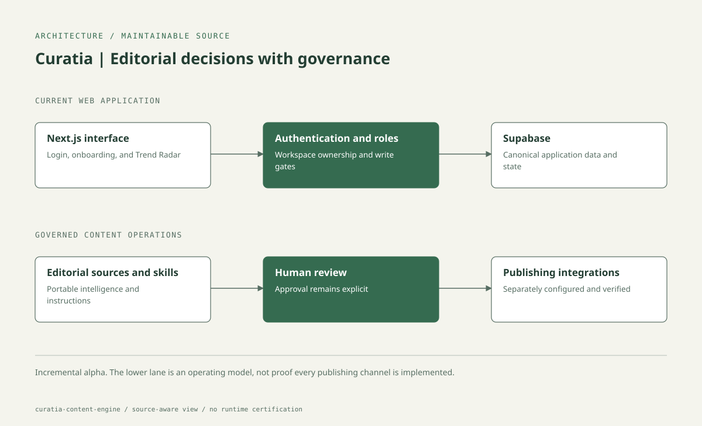

# Curatia

**Signals. Context. Decisions. Creation.**

Curatia is an editorial intelligence and content-operations platform. It connects source discovery, research, review, and content decisions while preserving workspace ownership and human approval boundaries.

**Application:** [curatia-content-engine.guilhermecosta.tech](https://curatia-content-engine.guilhermecosta.tech/) · **Stack:** Next.js 16, React 19, TypeScript, Supabase

> **Status: incremental alpha.** The repository contains a portable web application, SQL migrations, editorial skills, and recovery documentation. Target-architecture documents are plans, not proof that every integration, publishing channel, or automation is implemented.

## What is implemented

- Next.js pages for login, onboarding, home, settings, and Trend Radar.
- Server-side Supabase authentication/session helpers and workspace authorization predicates.
- Signal retrieval and a publications API route.
- Portable editorial instructions, skill packs, source-registry contracts, and automation specifications.
- Versioned database migrations and documented operational recovery paths.

Publishing, operational workers, database permissions, and hosted configuration require their own verification. Passing a web build does not validate those external systems.

## Architecture



[Editable HTML/SVG source](docs/architecture.html) · [Diagram style](docs/assets/architecture.style.json)


Git contains portable source and contracts. Supabase holds live application data and workflow state. The hosting platform holds runtime settings; scheduled workers and publishing integrations are separately operated. Do not move canonical data into this repository.

## Local development

Use Node.js 22 for parity with CI:

```bash
cd app
npm ci
npm run dev
```

Create `app/.env.local` using the **setting names** in the root `.env.example`, populated through your authorized development environment. Never copy production values into source control or chat. Authentication/data access requires a configured development Supabase project; static build checks can run without production credentials.

| Setting | Boundary |
| --- | --- |
| `NEXT_PUBLIC_SUPABASE_URL` | Public development project URL |
| `NEXT_PUBLIC_SUPABASE_PUBLISHABLE_KEY` | Browser-safe publishable key; never a service secret |
| `SUPABASE_URL` | Server-side project endpoint |
| `SUPABASE_SECRET_KEY` | Server-only secret; never exposed to browser code |
| `CURATIA_BOOTSTRAP_OWNER_EMAIL` | Operator-controlled bootstrap identity |

Do not disable authorization or substitute a service secret for a publishable key to make local login work. Apply migrations only to the intended development database after reviewing them.

## Verification

From `app/`:

```bash
npm run lint
npm run typecheck
npm audit --omit=dev --audit-level=high
npm run build
```

`typecheck` generates Next.js route types before invoking TypeScript. ESLint uses a flat configuration compatible with Next.js 16; `next lint` is not a supported command. CI installs the lockfile with `npm ci`, runs with read-only repository permissions, and does not deploy or write back changes.

A production build creates `app/.next/`; run it locally with `npm start`. Test authentication, membership isolation, role restrictions, database RLS, and publishing approval against a dedicated development environment before release. No complete end-to-end security or integration-test coverage is claimed.

## Project structure

| Path | Responsibility |
| --- | --- |
| `app/src/app/` | App Router pages, server actions, publications endpoint |
| `app/src/components/` | Application UI |
| `app/src/lib/` | Authentication, authorization, sessions, signal/data boundaries |
| `app/src/proxy.ts` | Request/session proxy |
| `supabase/` | Reviewed database migrations |
| `project/` | Portable Project instructions, skills, editorial resources and specs |
| `docs/` | Architecture, lifecycle, current state and alpha baseline |
| `site/` | Existing deployment and recovery notes during migration |

## Product direction and recovery

The approved target baseline is [CURATIA-ALPHA-BASELINE.md](docs/CURATIA-ALPHA-BASELINE.md). Work toward it incrementally: preserve canonical Trend Radar data, introduce workspace ownership safely, retain approval governance, and validate each phase before cutover.

For current-state recovery, read:

1. [Project bootstrap](project/PROJECT-BOOTSTRAP.md)
2. [Current state](docs/CURRENT-STATE.md)
3. [Site state](site/CURRENT-SITE-STATE.md)

Keep the existing production URL stable. Renaming, domain changes, scheduler activation, migrations, and production deployment are separate release decisions.

## Database migration history

The active migration directory mirrors the versions already applied in Supabase. Historical SQL is hash-verified; obsolete planning drafts are archived outside the active migration path. See [migration-history guidance](supabase/README.md). This source reconciliation does not execute SQL or repair production migration records.


## Contributing, security, and releases

Use scoped development branches and synthetic fixtures. Keep tests, recovery documentation, and migration history. Exclude `.next`, dependencies, incremental compiler caches, logs, and private environment files from Git.

Never commit Supabase secrets, OAuth tokens, integration credentials, DNS verification values, or private source data. Report sensitive findings privately rather than in public issues.

The application package is private; it is not a published npm library. A deployment is not automatically a GitHub Release. The source is licensed under the [MIT License](LICENSE). GitHub computes the Languages panel from tracked source; generated assets should not be used to exaggerate the implementation.
